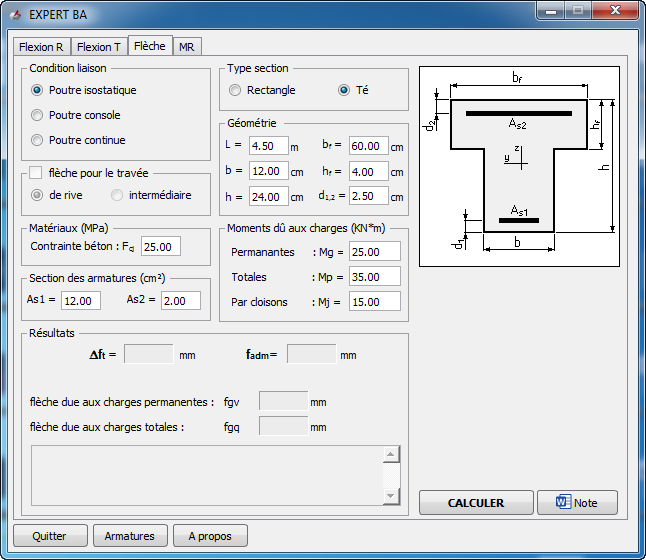
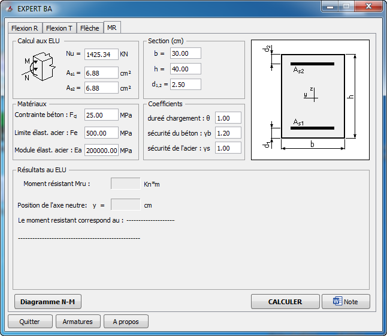

# BaelR
BaelR – BAEL 91 mod. 99
Application de calcul et de vérification des éléments en béton armé selon le règlement BAEL 91 modifié 99.

Fonctionnalités principales
- Flexion simple (section rectangulaire et section T).
- Flexion composée.
- Calcul du moment résistant Mrd.
- Diagramme d'interaction N-M.
- Calcul de la flèche des poutres.
- Génération automatique des notes de calcul Word.
Technologies

Python 3.8 · PyQt5 · Windows

Développé par : Morsli Hammou
## 🖥️ Captures d'écran

### Calcul de flexion simple et composée – Section rectangulaire (R)

### Calcul de flexion simple – Section en T

### Calcul de la flèche

### Calcul du moment résistant (MRd)

